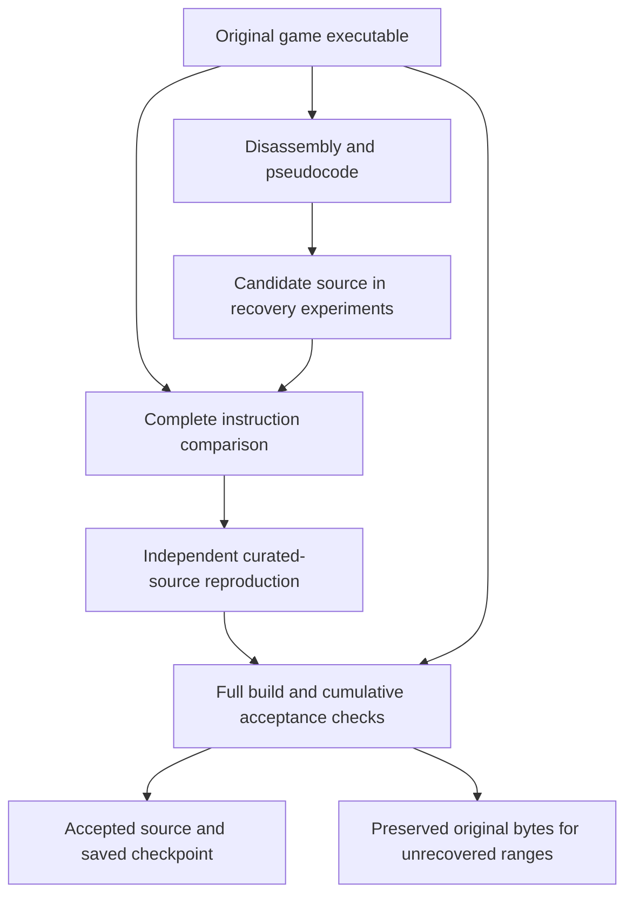

# What this Codex folder contains

This is a working reverse-engineering project for **Kingdom Hearts II Final Mix, Japanese PlayStation 2 release**. Its goal is to recover source code that compiles into the same instructions as the original game executable, `SLPM_666.75`.

The folder name identifies the workspace used by the coding agent. This is not the Codex application's installation or settings folder. It contains research, experiments, evidence, and coordination documents for the game project.

For an explanation of **every individual child directory**, including database internals and historical copies, see [DIRECTORY_INDEX.md](DIRECTORY_INDEX.md). The tables below explain the larger groups and how they relate.

## The top level

| Location | Purpose |
| --- | --- |
| `AGENTS.md` | Launch router for AI agents: which files a worker, the orchestrator, or an unlaunched agent must read first. |
| `STATUS.md` | **Start here.** Current accepted counts, checkpoint, gate, locations and open work. Updated after each accepted checkpoint. |
| `PLAYBOOK.md` | How the project should be run: roles, cadence, definitions of done, quality rules, and risk management. |
| `GLOSSARY.md` | Plain-language definitions of the project's terms (fallback range, checkpoint, curated source, and so on). |
| `HANDOFF.md` | Stable workflow, locations, identity hashes and rules for continuing the project. Counts live in `STATUS.md`. |
| `WORKER_BRIEF.md` | Guidance for a cooperating worker: scope, evidence requirements, tools, hard boundaries and the return package. |
| `HANDOFF.pre-2026-10-08.md` | Preserved earlier handoff (2026-10-07). |
| `archive/` | Unmodified copies of documents before they were rewritten, each batch with `SHA256SUMS.txt`. |
| `orchestration/` | The orchestrator plan (`ORCHESTRATION.md`), its recipes, worker and reviewer briefs, logs, and the helper tools in `orchestration/tools/`. Worker output goes to `analysis/final-mix/recovery-experiments/orch-shift1/`. |
| `EIGHT_HOUR_REPORT.md`, `DIRECTORY_INDEX.md` | Report on the 2026-10-11 run, and the per-directory index. |
| `analysis/` | Almost all of the actual project contents. |
| `tools/` | Empty at the inventory snapshot. Shared tools were moved to the sibling `Public/tools/` directory. |

## The analysis folders

`analysis/coverage/` is the earlier **US-release** audit. Its main executable is `SLUS_210.05`. Its `binaries/`, `bdx/`, and `disc-scripts/` children contain extracted inputs and script material from that earlier target. These should not be confused with the Japanese Final Mix evidence.

`analysis/recovered-pseudocode/` contains 1,161 historical C-like function exports from reference work: 1,044 under `SLUS_210.05/`, 59 under `ovl_gumibattle.x/`, and 58 under `ovl_gumimenu.x/`. These are pseudocode, not automatically verified recovered source.

`analysis/final-mix/` is the active Japanese Final Mix project. It contains the following child folders:

| Folder | What it contains |
| --- | --- |
| `binaries/` | Original extracted executable, sound and system modules, five overlays, and fourteen vector-unit programs. Its `PAD2/` child belongs to the extracted system-module inputs. |
| `disc-scripts/` | Original extracted script payloads, separated into `ai/`, `area_script/`, and `event_script/`. |
| `bdscript/` | Readable AI-script disassembly. |
| `area-script-source/` | Generated text representations of area scripts. |
| `event-script-source/` | Generated XML representations of event scripts. |
| `rebuilt-bdx/` | AI payloads reconstructed from the generated script forms. |
| `rebuilt-area-script/` | Reconstructed area-script payloads. |
| `rebuilt-event-script/` | Reconstructed event-script payloads. |
| `ghidra-projects/` | Saved projects for the binary-analysis tool Ghidra. Its database directories and module subdivisions are analysis storage. |
| `ghidra-mcp-projects/` | A separate Ghidra project snapshot used by the local tool integration. It can lag behind the authoritative analysis project. |
| `native-pseudocode/` | Generated C-like exports, module inventories, boundary comparisons, warnings, and repair findings. Some exports omit arguments, floating-point values, calls, or return values. |
| `recovery-drafts/` | Early source ideas awaiting proof. |
| `recovery-experiments/` | Candidate C++ sources, compiler logs, exact-byte comparisons, rejected hypotheses, and curated proposals. Subfolders separate individual investigations and runs. |
| `native-build/` | Saved compiler and executable artifacts, verified function ranges, input provenance, and acceptance receipts. |
| `accepted-snapshots/` | Preserved pre-change checkpoints. Each dated batch directory keeps previous registries and build evidence so changes remain auditable and recoverable. |
| `worker-coordination/` | Work queue, claims, reports, compiler ownership, live status, and run ledgers. Its worker and round subfolders preserve who investigated which addresses. |
| `tool-integrations/` | Setup findings and saved queries for Ghidra and evaluated external tools. |
| `path-migration-2026-10-08/` | Evidence that moving the workspace preserved files and their hashes. |

Files directly inside `final-mix/` tie these folders together: disc and archive inventories, script reconstruction summaries, hashes, build logs, and dated checkpoint manifests.

### How to read the deeper directories

The three `disc-scripts/` children separate AI (`ai/`), area logic (`area_script/`), and event logic (`event_script/`). Final Mix currently has 733 AI payloads, 727 area payloads, and 1,043 event payloads. Their corresponding readable-source and rebuilt folders retain those same payload counts.

Inside `native-pseudocode/`, `iop/` divides exports by 24 named `.IRX` system modules, while `overlays/` holds separately loaded game code. The `callback-*` and `jump-table-export/` folders preserve focused analysis and independently reopened exports. They document improvements to decompiler interpretation; they do not themselves replace game instructions.

The Ghidra `.rep/` children (`idata/`, `user/`, `versioned/`, and deeper indexed directories) are the tool's internal databases. Their many small files are storage details, not individually recovered game source files.

In `recovery-experiments/`, `delegated/` groups historical investigations by subject, `queue-run-20261009/` groups earlier worker runs, and `eight-hour-20261011/` contains this run's candidates, rejected variants, compiler logs, proof files, rationale, and complete directory inventories. A filename containing `verification` can describe a failed comparison; check its result rather than assuming acceptance.

In `worker-coordination/worker-b/`, numbered rounds and `variants*` folders preserve an earlier worker's investigations. `recovered/` contains its proposals. Acceptance is determined by the shared checkpoint, not by the folder's name. Python `__pycache__/` folders are generated interpreter caches.

Every `accepted-snapshots/` batch is a historical checkpoint copy. Similar-looking copies are intentional rollback and audit evidence. `path-migration-2026-10-08/` records the earlier directory move and its preservation checks. Some historical documents still use pre-migration tool paths; their current tools live under the sibling `Public/` tree.

## What “verified” means here

There are three different kinds of progress:

1. **Extracted or exported:** original bytes or generated pseudocode are available for investigation.
2. **Script reconstruction:** rebuilding a script produces the original bytes. Some unrecognized content is retained as data, so this does not prove complete understanding of every script instruction.
3. **Native instruction recovery:** a candidate function is compiled with the pinned PS2 compiler, compared against its complete original instruction range, independently checked, and accepted through a full-build checkpoint.

Some accepted C++ files use narrow inline assembly or register constraints to preserve the PS2 calling convention or exact instruction order. A verified C++ range is not necessarily a function written entirely in plain C++.

The full executable rebuild still includes original bytes for unrecovered functions and data. A matching executable therefore proves that accepted changes preserve the target; it does **not** mean the whole game has been rebuilt from recovered source. Names, class identities, some types, overlay interpretation, and runtime behavior remain provisional.

The main recovery path is:

Script reconstruction follows a separate path: extracted payloads in `disc-scripts/` become readable forms, then rebuilt payloads, then byte comparisons. Script and native-function results should be read separately.

Common file types help identify the contents:

| Type | Meaning in this workspace |
| --- | --- |
| `.cpp` | Candidate or curated C++ source; its acceptance status requires a proof and checkpoint. |
| `.c` under `recovered-pseudocode/` | Historical generated C-like text, not accepted compiler recovery. |
| `.json` | Inventories, comparison results, manifests, warnings, or coordination records. Read the result fields. |
| `.jsonl` | One JSON record per line, often one exported function per record. |
| `.log` and `.txt` | Compiler diagnostics, build output, disassembly, or investigation notes. |
| `.elf` and the release-named executable | Native executable artifacts; distinguish the original, linked intermediate, and normalized rebuild. |
| `.IRX` | Extracted PS2 system-module binaries. |
| `.x` | Separately loaded game overlays. |
| `.bdx`, `.area-script`, `.event` | Extracted or reconstructed script payloads. |
| `.bdscript` and event `.xml` | Readable generated script representations. |
| `.tsv` | Tab-separated registries or inventories. |
| `.py` | Local extraction, probing, comparison, or audit helpers. |
| `.gpr` and `.rep/` | Ghidra project entry and database storage. |
| `.sqlite3` | Persistent work queue or its explicitly preserved backup. |
| `.tar.gz` | Archived compiler artifacts or other bundled evidence. |

## Why the folder is large

The October 11 inventory snapshot found **393 directories, 150,050 files, and 2.14 GB** of contents, with no traversal errors. Approximately 117,000 files and 1.28 GB were preserved acceptance snapshots. Most files are JSON evidence or compiler logs, often copied into historical checkpoints. File count is not a count of recovered game functions.

The complete child-directory inventory is saved at `analysis/final-mix/recovery-experiments/eight-hour-20261011/codex-folder-inventory.json`. Counts are a snapshot; ongoing recovery creates more evidence.

A later inventory, after the final recovery batch was built, found **409 directories, 171,056 files, and 2.31 GB**, again with no traversal errors. It is preserved separately as `codex-folder-inventory-final.json`; the earlier inventory remains unchanged. Both inventories list every reachable child directory. Directory links are not followed.

The largest groups in that later snapshot were:

| Group | Files, including children | Size |
| --- | ---: | ---: |
| Accepted checkpoint snapshots | 135,710 | 1.43 GB |
| Ghidra integration snapshot database | 61 | 179 MB |
| Files directly inside `final-mix/` | 193 | 169 MB |
| Native pseudocode and focused analysis exports | 145 | 169 MB |
| Authoritative Ghidra analysis database | 58 | 132 MB |
| Event-script XML | 1,043 | 51 MB |
| Recovery experiments and their child investigations | 19,246 | 44 MB |

The snapshot contains 124,752 JSON files and 25,888 logs. This explains why the directory can look enormous even though much of its content is audit history and generated analysis rather than distinct recovered source functions. A Ghidra database can occupy substantial space in relatively few files; checkpoint evidence has the opposite pattern.

## Where the working source and tools actually live

The related sibling directory `C:/Users/KoZa/Documents/AGENTS/Public/` contains the shared tools and compiler reference project. In particular, `Public/tools/kh2-reference/` holds the accepted source tree, function registry, layout, and original reference executable; `Public/tools/kh2-audit/` holds the verification helpers. The compiler runs in the separate WSL staging directory `/root/kh2fm-build`.

For the latest accepted state, use the current hash-bound checkpoint and `analysis/final-mix/worker-coordination/eight-hour-run-20261011.json`. Earlier READMEs and handoffs retain historical counts. The run ledger distinguishes accepted batches from experiments that have not passed the full acceptance process.
