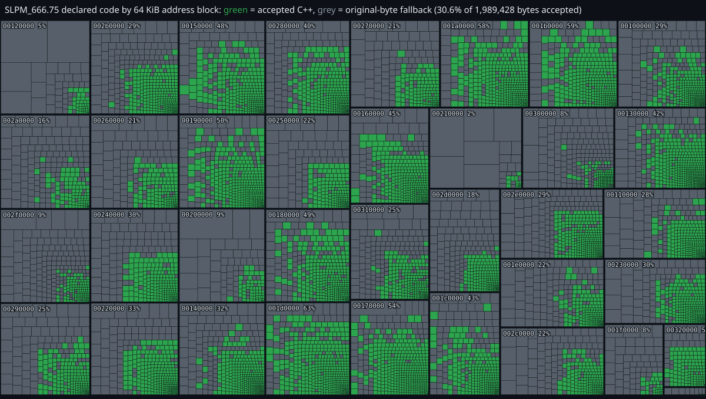

# Kingdom Hearts II Final Mix (JP) Decomp: recovery workspace

Research and recovery workspace for the Japanese PlayStation 2 release of Kingdom Hearts II Final Mix. The goal is C++ that the pinned original-era compiler turns into exactly the instructions of the main executable, `SLPM_666.75`.

It targets the same executable as [GovanifY/kh2](https://github.com/GovanifY/kh2) and builds on its layout and symbol approach. This repository holds the evidence, experiments and coordination around that work; the accepted source tree itself lives in the shared `Public/tools/kh2-reference` checkout (see [STATUS.md](STATUS.md#where-things-live)).

- SLPM\_666.75 sha256: `d869ce4b8edd61cb978c4ff9ede595fe4d7d7b21cbb96a145275217120d8bc87`
- Compiler: `kh2-local/ps2-compiler:3.2-ee-040921-objdiff`, flags `-O2 -g0 -x c++ -fno-exceptions -fno-rtti -fpermissive -ffunction-sections`

## Status

*Declared code of `SLPM_666.75` by 64 KiB address block. Each small cell is one function range sized by bytes; green is accepted C++, grey is still original-byte fallback. Regenerate with `python -I orchestration/tools/treemap.py`.*

| Measure | Value |
| --- | ---: |
| Functions matching the original instruction for instruction | 6,800 |
| Declared code ranges | 11,383 |
| Accepted share of declared code bytes | 19.8% (392,956 of 1,989,428) |
| Original-byte fallback ranges remaining | 4,579 (4,583 by byte coverage, counting the 4 padding cases) |
| Script payloads rebuilt byte-exact | 2,503 of 2,503 |

Whole-ELF equality holds, but the build starts from the original ELF and swaps in the registered C++ ranges, so this is not yet a source-only rebuild. Data and tables, IOP modules, overlays and vector-unit programs are not covered, and the byte share above is not a whole-game completion figure. Types, names, boundaries and runtime behavior are provisional. The live numbers are in [STATUS.md](STATUS.md).

## How it is run

Recovery is a queue of fallback ranges. A worker claims one address, writes C++ in an isolated directory, and proves it with the pinned compiler. Nothing counts until the full chain passes:

1. The compiled range equals the original range byte for byte.
2. The definition is curated and independently re-probed.
3. It is registered and built in full, ending in `MATCHED!`, with provenance and objdiff checks.
4. A checkpoint is saved and its gate passes.

Failed experiments are kept as evidence. See [HANDOFF.md](HANDOFF.md) for the rules, [PLAYBOOK.md](PLAYBOOK.md) for how the project is run, and [orchestration/ORCHESTRATION.md](orchestration/ORCHESTRATION.md) for the orchestrator and worker setup.

## Repository layout

| Path | Contents |
| --- | --- |
| [STATUS.md](STATUS.md) | Current counts, checkpoint, gate and open work. Start here. |
| [HANDOFF.md](HANDOFF.md), [PLAYBOOK.md](PLAYBOOK.md), [WORKER_BRIEF.md](WORKER_BRIEF.md), [GLOSSARY.md](GLOSSARY.md) | Rules, practice, worker guidance, terms |
| [FOLDER_GUIDE.md](FOLDER_GUIDE.md), [DIRECTORY_INDEX.md](DIRECTORY_INDEX.md) | What every folder holds |
| `orchestration/` | Orchestrator plan, recipes, briefs, logs and helper tools |
| `analysis/final-mix/` | The active Japanese Final Mix project: experiments, worker coordination, evidence |
| `archive/` | Unmodified copies of rewritten documents, each batch with `SHA256SUMS.txt` |
| `docs/` | Generated figures |

## Setup

You supply the game. Put `SLPM_666.75`, extracted from your own copy of the disc, in the shared reference checkout. Building needs Docker, WSL (`Ubuntu-24.04`) and Python 3. Builds run inside WSL at `/root/kh2fm-build`, never under `/mnt/c`. The accepted-snapshot, binary and Ghidra trees are not tracked here (see `.gitignore`).

## Disclaimer

This project is for research, preservation and interoperability. It does not include the game, its disc image or its executable, and you must own a legal copy to use it. Kingdom Hearts is a trademark of its respective owners; this project is not affiliated with or endorsed by them.

## License

No license has been chosen for this repository yet. The shared `kh2-reference` tree it builds on is MIT-licensed by its original author.
